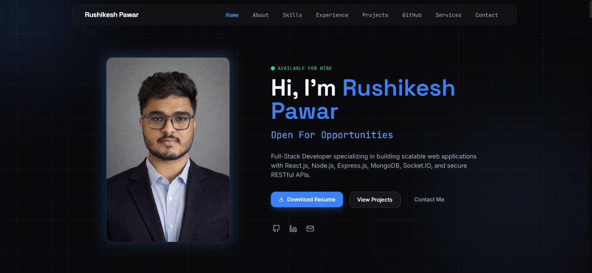
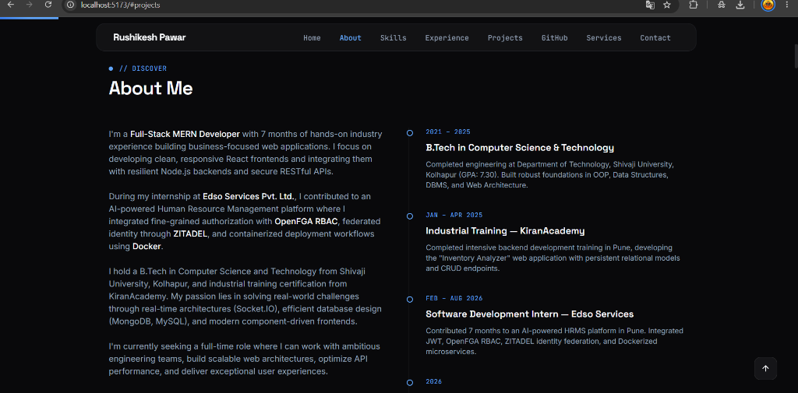
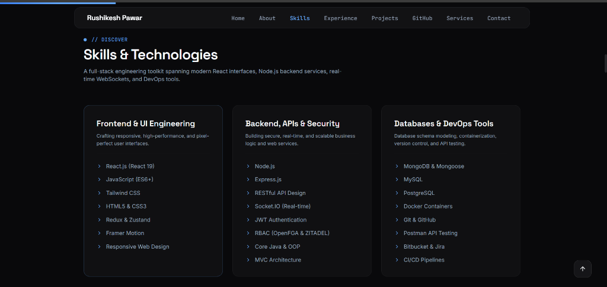
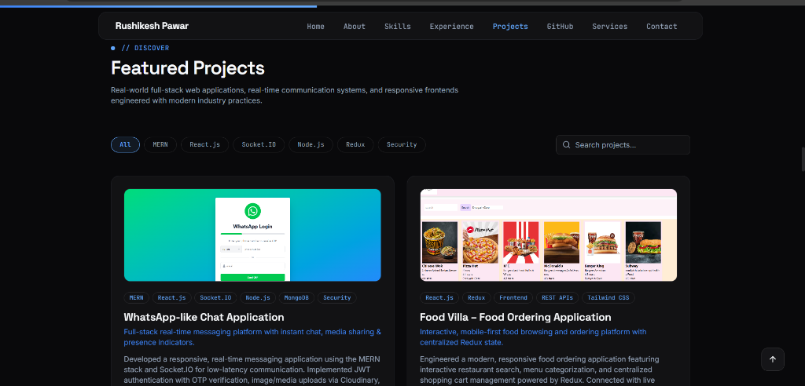
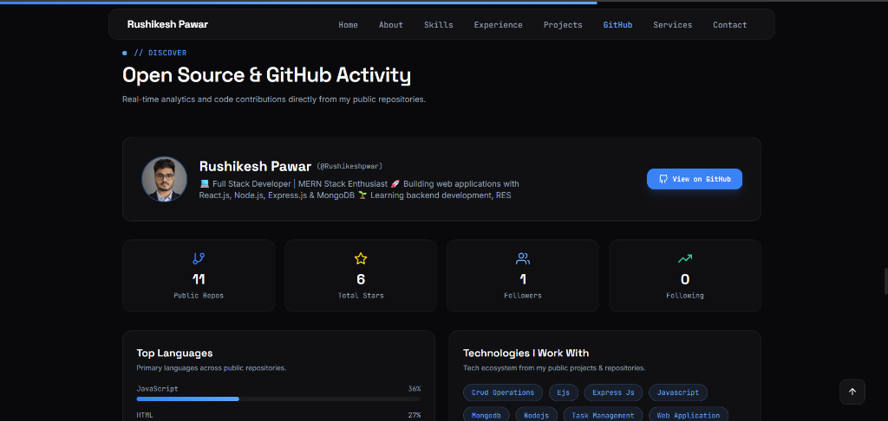

# 🚀 Rushikesh Pawar — Full-Stack Developer Portfolio

A modern, high-performance developer portfolio engineered with **React 19**, **Vite**, **Tailwind CSS**, and **Framer Motion**. Designed with a dark developer aesthetic, smooth animations, dynamic GitHub API metrics, case study routing, and direct EmailJS integration.

---

## 📸 Visual Showcase

### 1. Hero Section & Introduction


### 2. About Me & Professional Timeline


### 3. Technical Skills & Toolkit


### 4. Featured Projects with Real-Time Filters & Search


### 5. Open Source & Live GitHub Analytics


---

## 📁 Project Structure

```
rushikesh-portfolio/
├── public/                     # Static documents, verified certificates & assets
│   ├── favicon.svg             # Website favicon & Apple touch icon
│   ├── profilePic.jpeg         # Profile headshot
│   ├── Rushikesh_Resume_*.pdf  # Downloadable PDF resume
│   └── *_certificate.pdf / jpg # Verified internship & training certificates
├── src/
│   ├── assets/
│   │   └── screenshots/        # Portfolio UI screenshot showcase
│   ├── components/             # Reusable UI components
│   │   ├── BackToTop.jsx       # Floating scroll-to-top button
│   │   ├── Button.jsx          # Reusable action button component
│   │   ├── Footer.jsx          # Footer with social links & copyright
│   │   ├── Loader.jsx          # Page load animation
│   │   ├── Navbar.jsx          # Responsive glass navbar & mobile drawer
│   │   ├── ScrollProgressBar.jsx # Reading progress indicator
│   │   ├── ScrollToTop.jsx     # Route transition scroll restoration
│   │   └── SectionHeading.jsx  # Consistent section title with badges
│   ├── data/                   # Structured content & metadata
│   │   ├── experience.js       # Internship, education & certificates data
│   │   ├── profile.js          # Bio, roles, links & contact info
│   │   ├── projects.js         # Detailed project catalog & case study data
│   │   ├── skills.js           # Categorized technical toolkit
│   │   └── social.js           # Navigation links & capability services
│   ├── hooks/                  # Custom React hooks
│   │   └── useActiveSection.js # IntersectionObserver active link hook
│   ├── pages/                  # Page route components
│   │   ├── Home.jsx            # One-page portfolio layout
│   │   ├── NotFound.jsx        # 404 fallback page
│   │   └── ProjectDetail.jsx   # Dedicated deep-dive case study page
│   ├── sections/               # Modular landing page sections
│   │   ├── About.jsx           # Bio, key capabilities & timeline
│   │   ├── Certifications.jsx  # Verified course & training credentials
│   │   ├── Contact.jsx         # EmailJS contact form & direct cards
│   │   ├── Experience.jsx      # Work history & academic qualifications
│   │   ├── GithubStats.jsx     # Live GitHub API metrics & streak cards
│   │   ├── Hero.jsx            # TypeAnimation intro & call-to-actions
│   │   ├── Projects.jsx        # Interactive projects catalog & search
│   │   └── Services.jsx        # "What I Build" full-stack capabilities
│   ├── App.jsx                 # Application routes & layout wrapper
│   ├── index.css               # Tailwind directives & custom utilities
│   └── main.jsx                # React root entry point
├── .env.example                # Sample environment configuration
├── index.html                  # HTML template with mobile screen meta tags
├── package.json                # Project dependencies & scripts
├── tailwind.config.js          # Custom theme colors, keyframes & animations
└── vite.config.js              # Vite build tool configuration
```

---

## 🛠️ Tech Stack

### Core Frontend
- **React 19** — Component-driven reactive UI architecture
- **Vite** — Next-generation frontend build tooling
- **React Router DOM v7** — Client-side navigation & case study routing
- **Framer Motion** — Smooth layout transitions & scroll animations
- **React Type Animation** — Dynamic typing effect for engineering roles
- **Lucide React & React Icons** — Clean, scalable icon toolkit

### Styling & Design System
- **Tailwind CSS v3** — Utility-first styling with custom palette
- **Glassmorphism UI** — Translucent backdrop blur effects (`backdrop-blur-md`)
- **Responsive Mobile First** — Optimized for mobile, tablet, and desktop viewports
- **JetBrains Mono & Space Grotesk** — Modern developer typography

### Integrations & Services
- **GitHub REST API** — Live repository counts, stars, followers, and language percentages
- **EmailJS SDK** — In-browser email delivery directly to Gmail
- **React Toastify** — Real-time toast feedback notifications
- **GitHub Streak & Stats** — Visual SVG contribution streak analytics

---

## ✨ Key Features

- 📱 **Mobile-First Responsiveness**: Complete mobile screen optimization with notch support (`viewport-fit=cover`), theme colors for mobile address bars, and adaptive navigation drawers.
- ⚡ **Dynamic Typing Intro**: Engaging Hero section cycling through Full-Stack Developer, MERN Specialist, and Backend roles.
- 🔍 **Interactive Project Explorer**: Filter projects by tech stack tags (`MERN`, `React.js`, `Socket.IO`, `Security`) with instant keyword search.
- 📖 **Dedicated Project Case Studies**: Individual routes (`/projects/:id`) displaying architectural overviews, core features, and live links with automatic top-scroll restoration.
- 📊 **Real-Time GitHub Analytics**: Live metrics fetched directly from `api.github.com/users/Rushikeshpwar` with graceful offline fallback caching.
- 🎓 **Verified Credentials**: Direct preview links for internship experience letters and industrial training certificates.
- 📬 **Live Contact Delivery**: Fully functional contact form sending inquiries straight to Gmail via EmailJS with form validation.

---

## 🚀 Getting Started

### Prerequisites
- **Node.js** (v18.0.0 or higher recommended)
- **npm** or **yarn**

### 1. Clone the repository
```bash
git clone https://github.com/Rushikeshpwar/Rushikesh-Personal-portfolio.git
cd Rushikesh-Personal-portfolio
```

### 2. Install dependencies
```bash
npm install
```

### 3. Configure environment variables
Create a `.env` file in the root directory based on `.env.example`:
```bash
cp .env.example .env
```

Fill in your configuration:
```env
VITE_PROFILE_PHONE="+91 7276279206"
VITE_PROFILE_EMAIL="pawarrushikesh4949@gmail.com"
VITE_PROFILE_GITHUB="https://github.com/Rushikeshpwar"
VITE_PROFILE_LINKEDIN="https://www.linkedin.com/in/rushikesh50/"
VITE_PROFILE_RESUME_URL="/Rushikesh_Resume_7276279206.pdf"

# EmailJS Service Configuration
VITE_EMAILJS_SERVICE_ID=service_is73prq
VITE_EMAILJS_TEMPLATE_ID=template_g8zx9m6
VITE_EMAILJS_PUBLIC_KEY=xnfLlbe_2gw9v7v9U
```

### 4. Start the development server
```bash
npm run dev
```
Open [http://localhost:5173](http://localhost:5173) in your browser.

### 5. Build for production
```bash
npm run build
```

---

## 🌐 Connect with Me

- **Portfolio**: [Rushikesh Pawar](https://github.com/Rushikeshpwar)
- **LinkedIn**: [linkedin.com/in/rushikesh50](https://www.linkedin.com/in/rushikesh50/)
- **GitHub**: [github.com/Rushikeshpwar](https://github.com/Rushikeshpwar)
- **Email**: [pawarrushikesh4949@gmail.com](mailto:pawarrushikesh4949@gmail.com)

---

## 📄 License

This project is open-source and available under the [MIT License](LICENSE).
